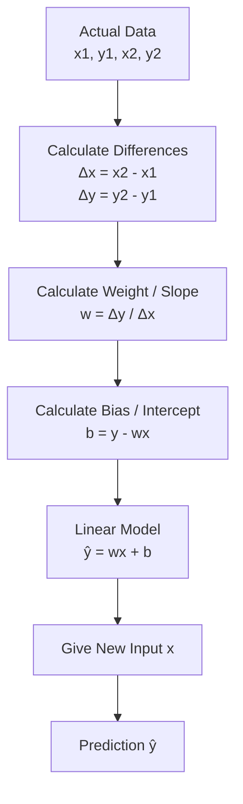

# Linear Regression

Linear Regression finds the relationship between an **input** and an **output** and uses that relationship to make predictions.

Example:

- Input (`x`) = Years of Experience
- Output (`y`) = Salary

---

## Main Formula

```text id="au8wq7"
prediction = weight * input + bias
```

Mathematically:

```text id="2dsjhr"
ŷ = wx + b
```

Where:

- `x` = Input
- `y` = Actual Output
- `ŷ` = Predicted Output
- `w` = Weight / Slope
- `b` = Bias / Intercept

---

## How Linear Regression Works



---

## 1. Weight / Slope

Weight tells us the **pace at which output changes when input changes**.

Formula:

```text id="ps2v9o"
weight = output difference / input difference
```

Or:

```text id="nb9mja"
w = (y2 - y1) / (x2 - x1)
```

Example:

```text id="37uaxq"
Point 1:
x1 = 3
y1 = 4700

Point 2:
x2 = 7
y2 = 10300
```

Calculate differences:

```text id="8n21xd"
Input Difference = 7 - 3
                 = 4

Output Difference = 10300 - 4700
                  = 5600
```

Calculate weight:

```text id="9t01gv"
weight = 5600 / 4

weight = 1400
```

This means the output changes by `1400` for every `1` unit increase in input.

---

## 2. Bias / Intercept

Bias represents the **base value** of the line.

Formula:

```text id="zy1pml"
bias = actual_output - (weight * input)
```

Or:

```text id="w1zxy2"
b = y - wx
```

Example:

```text id="7m52ae"
bias = 4700 - (1400 * 3)

bias = 4700 - 4200

bias = 500
```

Therefore:

```text id="qlvyww"
bias = 500
```

---

## 3. Build the Model

Now we know:

```text id="g4i0tm"
weight = 1400
bias = 500
```

So our Linear Regression model becomes:

```text id="zxxv69"
prediction = 1400 * input + 500
```

Or:

```text id="6v6lpe"
ŷ = 1400x + 500
```

---

## 4. Make a Prediction

Suppose we want to predict the salary for:

```text id="gk7pnm"
input = 10
```

Use our model:

```text id="rbex0c"
prediction = (1400 * 10) + 500
```

Calculate:

```text id="rf2ncb"
prediction = 14000 + 500

prediction = 14500
```

Final prediction:

```text id="vk4br9"
14500
```

---

## Python Program Flow

Our Python program does not hard-code the weight or bias.

The user provides two actual observations:

```text id="vphoyc"
x1, y1
x2, y2
```

The program then calculates:

```text id="n7x2z9"
Input Difference
        ↓
Output Difference
        ↓
Weight / Slope
        ↓
Bias / Intercept
        ↓
Linear Model
        ↓
New Input
        ↓
Prediction
```

---

## Key Formulas

### Weight

```text id="swwg5m"
weight = (y2 - y1) / (x2 - x1)
```

### Bias

```text id="7z7g2e"
bias = y - (weight * x)
```

### Prediction

```text id="cn9nqf"
prediction = (weight * input) + bias
```

---

## Key Takeaways

**Weight / Slope (`w`)**

Tells us the **pace at which output changes when input changes**.

```text id="i66o4v"
change in output
---------------- = weight
change in input
```

**Bias / Intercept (`b`)**

Tells us the **base/starting value of the line**.

**Prediction (`ŷ`)**

Uses the learned weight and bias with a new input:

```text id="ilvhau"
prediction = weight * input + bias
```

So the complete process is:

```text id="w8glwr"
Actual Data
    ↓
Learn Weight
    ↓
Learn Bias
    ↓
Build Model
    ↓
New Input
    ↓
Prediction
```