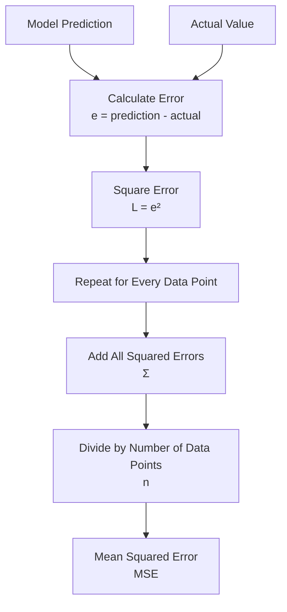

# Loss Function

A Loss Function tells us **how wrong our model's predictions are**.

In this lesson we use:

- Error / Residual
- Squared Error Loss
- Mean Squared Error (MSE)

---

## Data Point

A data point is the combination of an **input** and its **actual output**.

```text id="i2qyuw"
Data Point = (Input, Actual Output)
```

Example:

```text id="b89zq6"
Experience = 1 year
Salary = 1500

Data Point = (1, 1500)
```

Where:

- `x` = Input / Feature
- `y` = Actual Output / Target
- `(x, y)` = Data Point

---

## 1. Error

Error tells us the difference between the model's prediction and the actual value.

Formula:

```text id="c7pqqe"
error = prediction - actual
```

Mathematically:

```text id="wnkbhv"
e = ŷ - y
```

Where:

- `e` = Error
- `ŷ` = Prediction
- `y` = Actual Value

Example:

```text id="i6zhur"
Prediction = 18500
Actual = 20000

Error = 18500 - 20000

Error = -1500
```

The negative error means our prediction was lower than the actual value.

---

## 2. Squared Error Loss

We square the error to calculate the Squared Error Loss.

Formula:

```text id="mqpl2r"
L = e²
```

Example:

```text id="1os7ym"
Error = -1500

L = (-1500)²

L = 2250000
```

Squaring the error:

- Removes the negative sign
- Gives bigger mistakes a bigger penalty
- Makes the loss non-negative

---

## 3. Mean Squared Error (MSE)

When we have multiple data points, we calculate the squared error for every prediction.

Then we add all squared errors and divide by the number of data points.

Simple formula:

```text id="a2dp4u"
MSE = Sum of All Squared Errors / Number of Data Points
```

Mathematically:

```text id="pbqx83"
MSE = (1 / n) × Σ(ŷ - y)²
```

Where:

- `n` = Number of Data Points
- `Σ` = Sum / Add everything
- `ŷ` = Prediction
- `y` = Actual Value

---

## MSE Example

Suppose we have three squared errors:

```text id="2uvkrc"
10000
40000
90000
```

First add them:

```text id="sn53ar"
Total Squared Error

= 10000 + 40000 + 90000

= 140000
```

Number of data points:

```text id="dkvgnt"
n = 3
```

Calculate MSE:

```text id="i0txzq"
MSE = 140000 / 3

MSE = 46666.67
```

---

## How Loss Calculation Works



---

## Python Logic

The Python program follows the same mathematical process:

```text id="mk2q4b"
For Every Data Point
        ↓
Get Prediction
        ↓
Get Actual Value
        ↓
Error = Prediction - Actual
        ↓
Squared Error = Error²
        ↓
Add Squared Error to Total
        ↓
Repeat
        ↓
MSE = Total Squared Error / Number of Data Points
```

In Python:

```text id="p1msbb"
error = prediction - actual

squared_error = error ** 2

total_squared_error += squared_error

mse = total_squared_error / n
```

---

## Key Formulas

### Error

```text id="2z9tt6"
e = prediction - actual
```

### Squared Error Loss

```text id="9v8z4p"
L = e²
```

### Mean Squared Error

```text id="emssx1"
MSE = Sum of All Squared Errors / Number of Data Points
```

---

## Key Takeaways

**Data Point**

```text id="4fnguw"
(Input, Actual Output)
```

**Error**

Tells us how far the prediction is from the actual value.

```text id="x3e49h"
e = prediction - actual
```

**Squared Error Loss**

Squares the error.

```text id="wrbztq"
L = e²
```

**MSE**

Measures the average squared error across multiple data points.

```text id="v3e85m"
MSE = Total Squared Error / Total Data Points
```

The complete flow is:

```text id="lkm3wr"
Prediction + Actual
        ↓
Error
        ↓
Squared Error
        ↓
Repeat for all Data Points
        ↓
Sum
        ↓
Average
        ↓
MSE
```