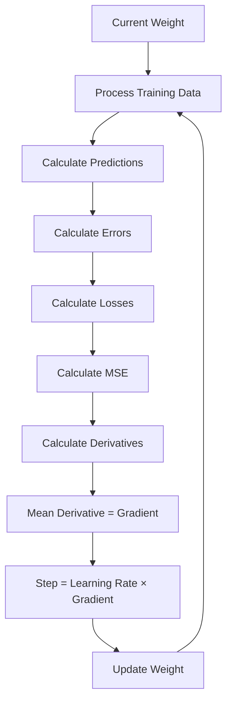

# Gradient Descent

## What is Gradient Descent?

Gradient Descent is an optimization algorithm.

Its goal is:

> Adjust model parameters so that Loss/MSE becomes smaller.

We are NOT trying to minimize the Weight.

We change the Weight to minimize the MSE.

---

## Connection to Previous Lessons

Our training flow is:

```text
Linear Regression
      ↓
Prediction = wx + b
      ↓
Error = Prediction - Actual
      ↓
Loss = Error²
      ↓
MSE = Mean Loss
      ↓
Derivative
      ↓
Gradient = dMSE/dw
      ↓
Gradient Descent
      ↓
Update Weight
```

---

## Starting Values

Training data:

| Input x | Actual y |
|---:|---:|
| 1 | 1500 |
| 2 | 2500 |
| 3 | 3500 |

Model parameters:

```text
Weight = 800
Bias = 500
```

From our Derivatives lesson:

```text
MSE = 186666.67
Gradient = -1866.67
```

We choose:

```text
Learning Rate = 0.01
```

Learning Rate is a hyperparameter.

---

## Gradient Descent Formula

\[
w_{new}
=
w_{old}
-
(\alpha \times Gradient)
\]

Where:

- `w_old` = current Weight
- `α` = Learning Rate
- `Gradient` = dMSE/dw
- `w_new` = updated Weight

---

## First Weight Update

We have:

\[
w_{old}=800
\]

\[
Gradient=-1866.67
\]

\[
\alpha=0.01
\]

Calculate the step:

\[
Step=0.01\times(-1866.67)
\]

\[
Step=-18.67
\]

Update the Weight:

\[
w_{new}=800-(-18.67)
\]

\[
w_{new}=818.67
\]

Therefore:

```text
800 → 818.67
```

---

## Why Did Weight Increase?

Our Gradient was negative.

```text
Gradient = -1866.67
```

Gradient Descent subtracts the Gradient:

```text
800 - (-18.67)
```

Subtracting a negative becomes addition:

```text
800 + 18.67
```

Therefore the Weight increases.

---

## Learning Rate

Learning Rate controls how much of the Gradient we use for each update.

```text
0.1    → larger step
0.01   → smaller step
0.001  → even smaller step
```

Learning Rate is normally chosen as a training hyperparameter.

The actual update step is:

\[
Step=\alpha\times Gradient
\]

---

## Training Loop

After updating the Weight, training does not stop.

The new Weight is used to process the dataset again.



---

## Epoch

One complete pass through the entire training dataset is called an:

**Epoch**

For our dataset:

```text
Epoch 1
x=1
x=2
x=3
↓
Calculate MSE
↓
Calculate Gradient
↓
Update Weight

Epoch 2
x=1
x=2
x=3
↓
Calculate new MSE
↓
Calculate new Gradient
↓
Update Weight

Repeat...
```

---

## Key Formulas

Prediction:

\[
Prediction=wx+b
\]

Error:

\[
Error=Prediction-Actual
\]

Loss:

\[
Loss=Error^2
\]

Derivative:

\[
\frac{dLoss}{dw}=2\times Error\times Input
\]

Gradient:

\[
Gradient=\frac{dMSE}{dw}
\]

Step:

\[
Step=\alpha\times Gradient
\]

Weight Update:

\[
w_{new}=w_{old}-Step
\]

---

## Key Takeaways

- Gradient is the mean derivative in our current MSE example.
- Gradient tells us how MSE changes with Weight.
- Learning Rate controls the update step.
- Learning Rate is a hyperparameter.
- We update Weight to reduce MSE.
- We do NOT try to minimize Weight itself.
- After updating Weight, the dataset is processed again.
- One complete pass through the dataset is an Epoch.
- Training repeats until the model reaches a sufficiently low Loss.