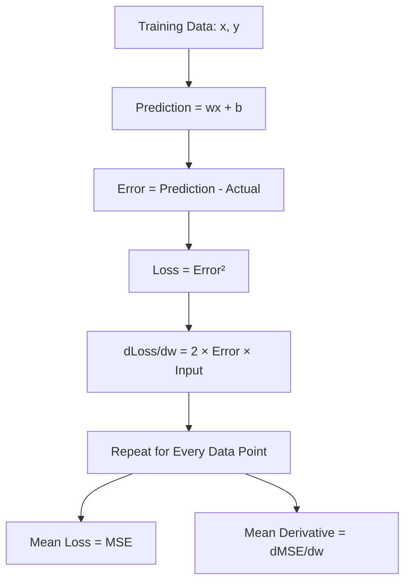

# Derivatives

## What is a Derivative?

A derivative tells us how one value changes when another value changes.

In Machine Learning, we want to know:

> If the weight changes, how will the Loss change?

This is written as:

\[
\frac{dLoss}{dw}
\]

It means:

**Derivative of Loss with respect to Weight.**

---

## Starting Model

Our Linear Regression model is:

\[
Prediction = wx + b
\]

We use:

```text
w = 800
b = 500
```

Training data:

| Data Point | Input x | Actual y |
|---|---:|---:|
| 1 | 1 | 1500 |
| 2 | 2 | 2500 |
| 3 | 3 | 3500 |

---

## Step 1 — Prediction

Formula:

\[
Prediction = wx+b
\]

For Point 1:

\[
Prediction = 800(1)+500
\]

\[
Prediction = 1300
\]

---

## Step 2 — Error

Formula:

\[
Error = Prediction-Actual
\]

Point 1:

\[
Error = 1300-1500
\]

\[
Error=-200
\]

---

## Step 3 — Loss

We use Squared Error Loss:

\[
Loss=Error^2
\]

Point 1:

\[
Loss=(-200)^2
\]

\[
Loss=40000
\]

---

## Step 4 — Derivative of Loss

For Squared Error Loss:

\[
\frac{dLoss}{dw}
=
2 \times Error \times Input
\]

Point 1:

\[
\frac{dLoss}{dw}
=
2\times(-200)\times1
\]

\[
\frac{dLoss}{dw}
=
-400
\]

---

## Why Does `2 × Error` Appear?

Our Loss is:

\[
Loss=Error^2
\]

The derivative of:

\[
Error^2
\]

with respect to Error is:

\[
\frac{dLoss}{dError}=2\times Error
\]

Therefore the final derivative with respect to Weight becomes:

\[
\frac{dLoss}{dw}
=
2\times Error\times Input
\]

---

## Dry Run

| Point | Input | Actual | Prediction | Error | Loss | dLoss/dw |
|---|---:|---:|---:|---:|---:|---:|
| 1 | 1 | 1500 | 1300 | -200 | 40,000 | -400 |
| 2 | 2 | 2500 | 2100 | -400 | 160,000 | -1,600 |
| 3 | 3 | 3500 | 2900 | -600 | 360,000 | -3,600 |

---

## Mean Loss

First we calculate the mean of all Losses:

\[
MSE=
\frac{40000+160000+360000}{3}
\]

\[
MSE=186666.67
\]

So:

**Mean of Losses = MSE**

---

## Mean Derivative

Now calculate the mean of all derivatives:

\[
\frac{dMSE}{dw}
=
\frac{-400-1600-3600}{3}
\]

\[
\frac{dMSE}{dw}
=
-1866.67
\]

So:

**Mean of Derivatives = dMSE/dw**

---

## How It Works



---

## Key Formulas

Prediction:

\[
Prediction=wx+b
\]

Error:

\[
Error=Prediction-Actual
\]

Loss:

\[
Loss=Error^2
\]

Derivative for one data point:

\[
\frac{dLoss}{dw}=2\times Error\times Input
\]

Mean Loss:

\[
MSE=\frac{\sum Loss}{n}
\]

Mean Derivative:

\[
\frac{dMSE}{dw}
=
\frac{\sum(dLoss/dw)}{n}
\]

---

## Key Takeaways

- `w` is the Weight.
- `dLoss/dw` is the derivative for one data point.
- `dLoss/dw = 2 × Error × Input`.
- Every data point has its own Loss.
- Every data point has its own derivative.
- Mean of Losses gives MSE.
- Mean of derivatives gives `dMSE/dw`.
- `dw` does NOT mean number of data points.
- `n` means number of data points.
- At `w = 800`, our `dMSE/dw = -1866.67`.

The next concept is **Gradient Descent**, where this derivative will be used to update the Weight.